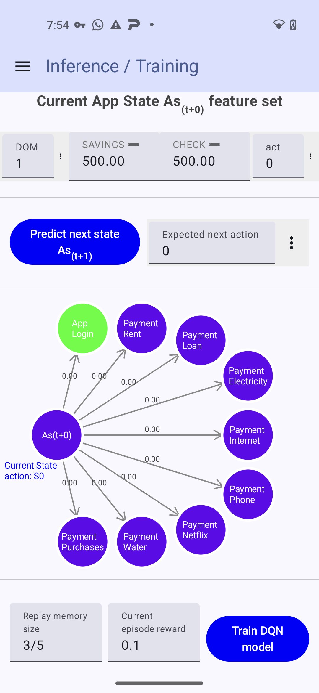
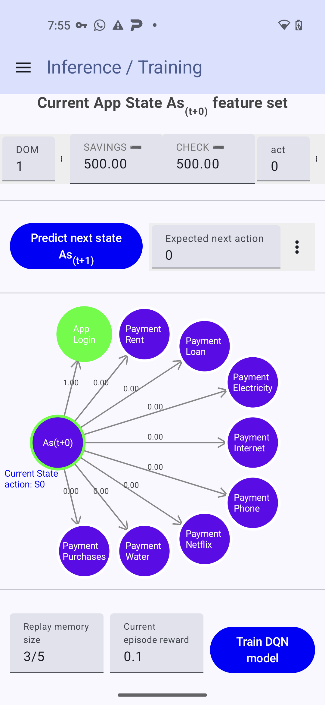
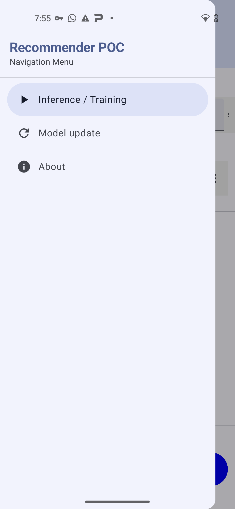
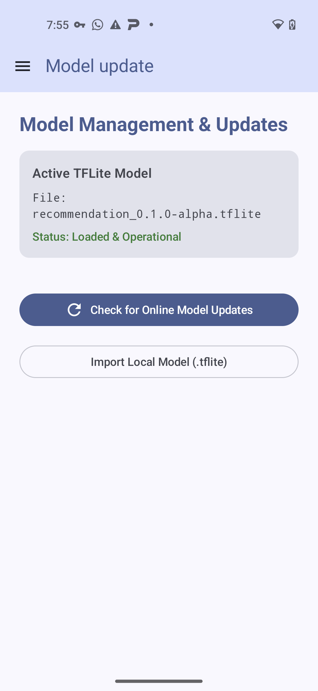
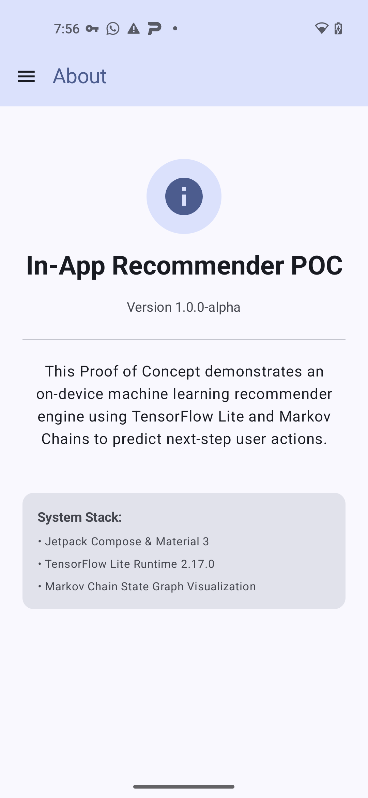
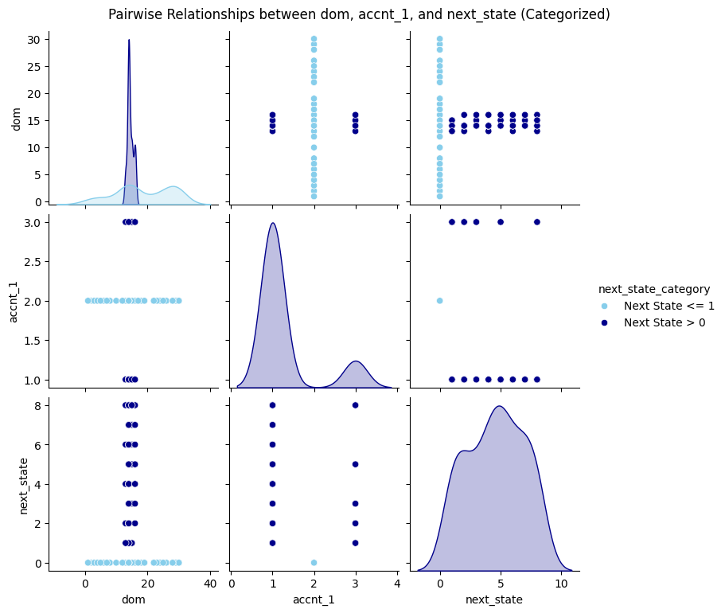
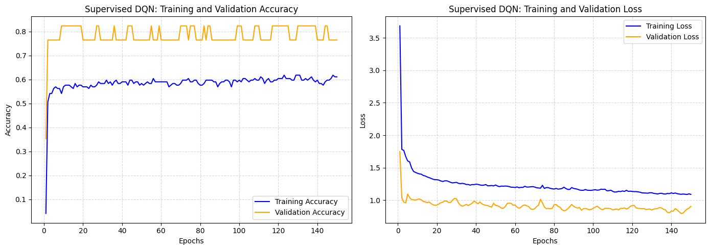
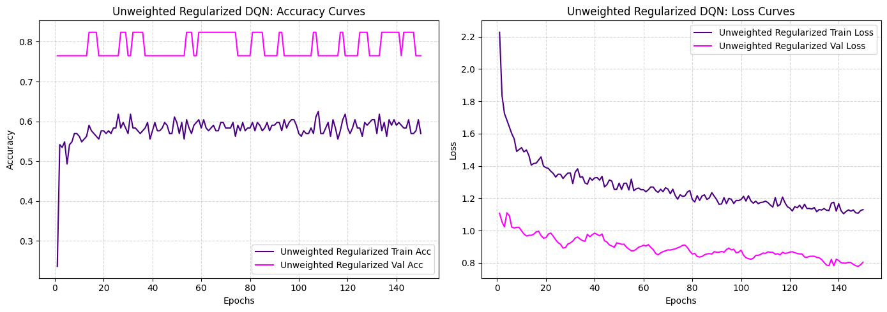
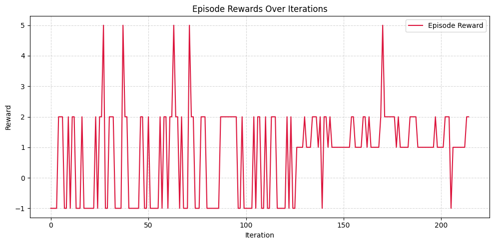
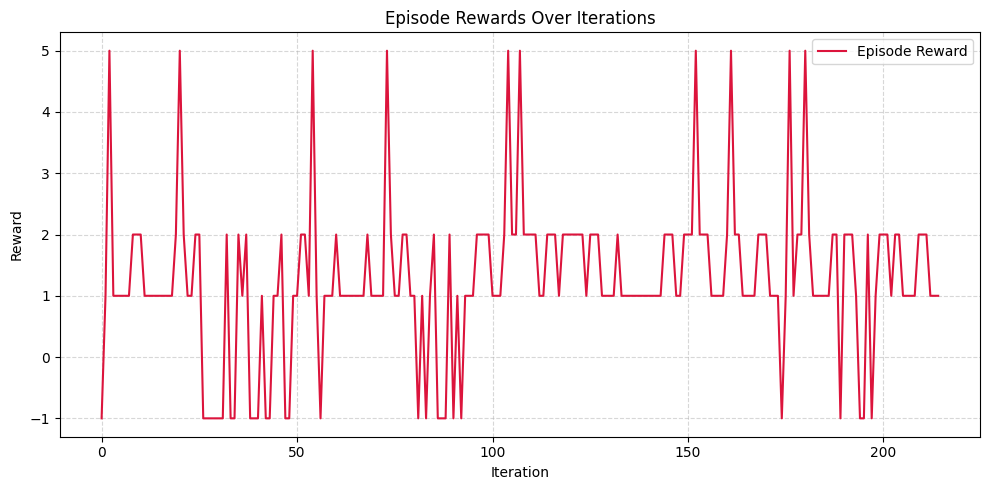

# TFLite DQN Recommender Engine (Android POC)

[](https://kotlinlang.org)
[](https://developer.android.com)
[](https://www.tensorflow.org/lite)
[](https://developer.android.com/jetpack/compose)

An on-device machine learning recommendation system for Android built with **TensorFlow Lite (LiteRT)**, **Deep Q-Networks (DQN)**, and **Jetpack Compose**. The system predicts a user's next action in a mobile banking application based on user session state variables, visualizing transition dynamics with dynamic Markov chain probability graphs and performing on-device reinforcement learning.

---

## 📱 Application Views & Features

The mobile application demonstrates real-time state inference, local experience replay training, model lifecycle management, and dynamic state graph visualization.

| Inference / Training (Initial) | Inference / Training (Predicted) |
| :---: | :---: |
|  |  |
| *Input user state features ($A_{s(t+0)}$) and Markov state graph initial state.* | *Predicted next action ($A_{s(t+1)}$) with updated Markov chain transition probabilities.* |

| Navigation Drawer | Model Management & Updates | About View |
| :---: | :---: | :---: |
|  |  |  |
| *Slide-out Material 3 navigation drawer.* | *Manage active TFLite model, check for online updates, or load local models.* | *Application architectural details and system stack overview.* |

### Key App Features
- **Real-Time On-Device Inference**: Runs TFLite model inference (`sig_dqn_model.tflite`) directly on mobile hardware without requiring cloud round-trips.
- **Interactive Markov Chain Graph**: Renders a dynamic Compose canvas state graph depicting transition probabilities from the current state $A_{s(t+0)}$ to candidate target actions $A_{s(t+1)}$.
- **(Work in progress) Local Experience Replay & On-Device Training**: Supports local memory buffer collection and model tuning to adapt to individual user behavior.
- **(Work in progress) Model Lifecycle Management**: Allows toggling, updating online, or importing new local `.tflite` model files.

---

## 🧠 Underlying Deep Learning Model (`python/DQN_Rec.ipynb`)

The recommendation model is designed and trained in Python using **TensorFlow / Keras**. The codebase is structured around a supervised Deep Q-Network (DQN) pipeline tailored to user interactions from a time-series banking dataset.

### 1. Neural Network Architecture

The repository implements three main variations of the network:

```
                      ┌─────────────────────────┐
                      │ Input State Vector (6)  │
                      └────────────┬────────────┘
                                   │
                      ┌────────────▼────────────┐
                      │   Dense Layer (128)     │  + ReLU
                      └────────────┬────────────┘
                                   │
                      ┌────────────▼────────────┐
                      │   Dropout Layer (0.10)  │  (Regularized DQN)
                      └────────────┬────────────┘
                                   │
                      ┌────────────▼────────────┐
                      │   Dense Layer (64)      │  + ReLU
                      └────────────┬────────────┘
                                   │
                      ┌────────────▼────────────┐
                      │   Dropout Layer (0.10)  │  (Regularized DQN)
                      └────────────┬────────────┘
                                   │
                      ┌────────────▼────────────┐
                      │  Output Q-Values (9)    │
                      └─────────────────────────┘
```

- **`DQN`**: Base sequential network consisting of Dense hidden layers (128 units, 64 units) with ReLU activations.
- **`RegularizedDQN`**: Enhanced architecture inserting `Dropout(0.10)` after dense layers. Dropout acts as a regularizer during training to prevent the network from memorizing imbalanced training samples.
- **`SignatureRegularizedDQN`**: Final TensorFlow Lite / LiteRT compatible version using concrete signatures (`@tf.function(input_signature=...)`) to avoid untracked resource variable serialization issues during TFLite conversion.

### 2. Feature & Action Space Schema

- **Input Feature Vector ($N=6$)**:
  1. `dom`: Day of the month.
  2. `accnt_1`: Savings account status / categorical index.
  3. `accnt_2`: Checking account status / categorical index.
  4. `user-action`: Current active user action ($S_0$).
  5. `total-sessions`: Cumulative user sessions.
  6. `session-duration`: Elapsed session time.
- **Output Action Space ($K=9$)**:
  `0: App Login`, `1: Payment Rent`, `2: Payment Loan`, `3: Payment Electricity`, `4: Payment Internet`, `5: Payment Phone`, `6: Payment Netflix`, `7: Payment Water`, `8: Payment Purchases`.

---

## 📊 Dataset Exploration & Model Training Performance

The model is trained on user banking interaction sessions from the [Banking-Dataset](https://github.com/GilsonFrias/Banking-Dataset).

### Dataset Pairwise Feature Distributions


### 1. Supervised Learning Pipeline Metrics

In the supervised pipeline, the DQN architecture is optimized using categorical cross-entropy / classification loss to predict the target next state action directly.

| Supervised Baseline DQN | Supervised Regularized DQN (Dropout 0.10) |
| :---: | :---: |
|  |  |
| *High initial accuracy, but susceptible to overfitting on dominant non-transactional actions.* | *Dropout regularization smooths training validation accuracy and improves generalization.* |

- **Supervised Baseline Test Accuracy**: `83.84%` (Test Loss: `0.4578`)
- **Regularized DQN (Dropout 0.10) Test Accuracy**: `83.84%` (Test Loss: `0.4517`)

---

### 2. Reinforcement Learning Pipeline Metrics

In the RL pipeline, the agent interacts with user sessions using a custom environment and an experience replay memory buffer (`ReplayMemory`).

| RL Baseline DQN (From Scratch) | Fine-Tuned RL DQN (Transfer Learning) |
| :---: | :---: |
|  |  |
| *Learns policy from scratch: Cumulative Reward = 79.0, Avg MAE = 0.1583.* | *Transfer learning initialized from supervised weights: Cumulative Reward = -41.0, Avg MAE = 0.1370.* |

---

## 🔬 Performance Analysis & Exploration Paradox

Analyzing the reinforcement learning execution metrics revealed an interesting paradox between training from scratch versus using transfer learning:

- **Baseline DQN (From Scratch)**: Cumulative Reward = **`79.0`**, Avg MAE = **`0.1583`**
- **Pre-trained DQN (Transfer Learning)**: Cumulative Reward = **`-41.0`**, Avg MAE = **`0.1370`**

### Why did the Pre-trained model yield a lower Cumulative Reward?

1. **Supervised Initializer Bias**:
   The pre-trained weights were obtained by training the network as a classifier on an unbalanced dataset where non-transactional actions (`App Login`) represent the majority of samples. The supervised network heavily favored predicting the dominant class to minimize cross-entropy loss.
2. **The Exploration-Exploitation Dilemma & Policy Entrenchment**:
   Because weights were pre-trained, the Q-network started the RL phase with highly established, low-entropy predictions. Instead of exploring the action space homogeneously, the pre-trained agent strongly preferred its pre-established "safe" predictions. This trapped the agent in sub-optimal local minima where it continuously selected incorrect non-transactional actions, incurring persistent penalties (`non_match_weight = -1`) rather than discovering high-reward transactional actions.
3. **MAE vs. Reward Function Mismatch**:
   Mean Absolute Error (MAE) measures average index distance between predicted and true action indices. Safe predictions near the middle index yield a lower numerical deviation (MAE = `0.1370`). However, in reinforcement learning, rewards are discrete and sparse: a close miss incurs the same strict penalty as a far miss.

---

## 🛠️ LiteRT / TFLite Model Export Procedure

To export the trained Keras model for Android deployment without encountering untracked resource variable serialization errors:

```python
import tensorflow as tf

# 1. Define clean prediction function using explicit input signature
@tf.function(input_signature=[tf.TensorSpec(shape=[None, 6], dtype=tf.float32, name='app_state')])
def predict_fn(app_state):
    return keras_model(app_state, training=False)

# 2. Convert concrete function to TFLite format
converter = tf.lite.TFLiteConverter.from_concrete_functions([predict_fn.get_concrete_function()])
tflite_model = converter.convert()

# 3. Save TFLite asset
with open('app/src/main/assets/sig_dqn_model.tflite', 'wb') as f:
    f.write(tflite_model)
```

---

## 🚀 Getting Started

### Prerequisites
- **Android Studio**: Ladybug / 2024.2.1 or newer
- **JDK**: 17 or 21
- **Android Device / Emulator**: Running Android 7.0 (API 24) or higher
- **Python**: 3.10+ with `tensorflow>=2.17.0`, `pandas`, `numpy`, `matplotlib`, `seaborn`

### Building & Running the Android App

1. **Clone the Repository**:
   ```bash
   git clone https://github.com/GilsonFrias/RecommenderPOC.git
   cd RecommenderPOC
   ```

2. **Build the Debug APK**:
   ```bash
   ./gradlew :app:assembleDebug
   ```

3. **Install and Run on Connected Device**:
   ```bash
   adb install -r app/build/outputs/apk/debug/app-debug.apk
   adb shell am start -n com.gilsonfrias.recommenderpoc/.MainActivity
   ```

### Executing the Jupyter Notebook

To reproduce model training, evaluation, and TFLite model export:
```bash
jupyter notebook python/DQN_Rec.ipynb
```

---

## 📜 References & Acknowledgments
- [Deep Q-Networks Paper (Mnih et al.)](https://www.cs.toronto.edu/%7Evmnih/docs/dqn.pdf)
- [Lukas Schwarz DQN Tutorial](https://lukasschwarz.de/dqn)
- [TensorFlow Lite On-Device Training & Conversion](https://developers.google.com/edge/litert/conversion/tensorflow/build/ondevice_training)
- [Banking Interaction Dataset](https://github.com/GilsonFrias/Banking-Dataset)
